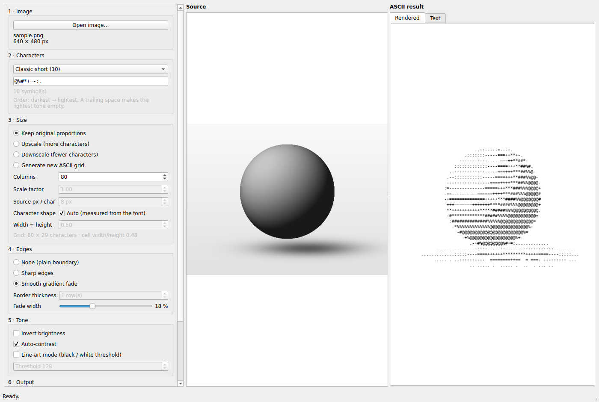

# ASCII Art Studio

[](https://github.com/YOUR_USERNAME/ascii-art-studio/actions/workflows/tests.yml)


A desktop application that turns any picture into **ASCII art** and saves it as **PNG**,
**JPEG** or **TXT**. Built with Qt (PySide6), Pillow and NumPy. It is packaged for
Arch Linux (`makepkg -si`) and runs on any Linux with Python 3.10+.



## Features

- **Live preview** of the source and the result, updated as you change any option.
  The heavy work runs on background threads, so the window never freezes.
- **Output formats:** PNG, JPEG (rendered onto a canvas) or plain TXT (one row per line).
- **Character sets:** five presets (long ramp, classic short, blocks, Unicode shades,
  two-tone) or your own symbols, darkest to lightest, in any length down to a single character.
- **Sizing:** keep original proportions, upscale, downscale, or *generate a new grid*
  recomputed from the source pixels. Character cells are taller than wide, and the
  aspect ratio is corrected so the output is not stretched.
- **Edge treatment:** none (default), *sharp* (solid frame) or *smooth gradient* where
  symbols thin out and fade toward the borders, with adjustable width.
- **Tone controls:** invert, auto-contrast and a line-art mode (pure black/white
  threshold, so the background stays empty).
- **Friendly errors:** unreadable files, invalid symbol sets and write failures produce
  clear messages instead of crashes.
- **Drag and drop** an image onto the window, or pass it on the command line.
- The conversion engine has no GUI dependency and is unit-tested.

Example output (64 columns, "Classic short" preset):

```text


                           ..:::---::.
                       .::::::---===++*+-
                     .:::::::::---===++*##+.
                   .::::::::::----===++**#%%=
                  .-:::::::::----===++**##%%@+
                 .--:::::::-----===++***##%@@@-
                 ------------====+++***##%%@@@%
                 ===------=====++++**###%%@@@@@
                 ++=========++++****##%%%@@@@@@
                 -*++++++++++****###%%%@@@@@@@*
                 .************####%%%@@@@@@@@@.
                  .*##########%%%%@@@@@@@@@@%:
                   .+%%%%%%%%%@@@@@@@@@@@@@*.
                     .+%@@@@@@@@@@@@@@@@@*:
                        -+#@@@@@@@@@@#+-.
               .............:-=====-:::::::::::::.............
         ...........::::---====++++*******++++====---::::.......
         ............::::::----===============-----:::::........
            ....................................................
................................................................
................................................................
```

## Installation

### Arch Linux (recommended): build a native package

```bash
sudo pacman -S --needed base-devel git
git clone https://github.com/YOUR_USERNAME/ascii-art-studio.git
cd ascii-art-studio
makepkg -si
```

Run `makepkg` as a normal user (it asks for `sudo` itself when installing). `-s` installs
the dependencies, `-i` installs the finished package, and the unit tests run
automatically before packaging.

Installed files:

| Path | Content |
|---|---|
| `/usr/bin/ascii-art-studio` | command |
| `/usr/lib/python3.*/site-packages/ascii_art_studio/` | application |
| `/usr/share/applications/ascii-art-studio.desktop` | menu entry (*Graphics*) |
| `/usr/share/icons/hicolor/scalable/apps/ascii-art-studio.svg` | icon |
| `/usr/share/licenses/ascii-art-studio/`, `/usr/share/doc/ascii-art-studio/` | license and docs |

Dependencies, all from the official repositories: `python`, `pyside6`, `python-pillow`,
`python-numpy`, `ttf-dejavu`, `hicolor-icon-theme` (optional: `qt6-wayland`).

Uninstall with `sudo pacman -R ascii-art-studio`.

### Other Linux distributions (pip + virtual environment)

```bash
git clone https://github.com/YOUR_USERNAME/ascii-art-studio.git
cd ascii-art-studio
python -m venv .venv
source .venv/bin/activate
pip install .
ascii-art-studio
```

You need a monospace TrueType font with block/shade glyphs (DejaVu Sans Mono is
recommended; Debian/Ubuntu: `fonts-dejavu-core`) and Qt's X11 libraries
(`libxcb-cursor0` on Debian/Ubuntu). For development, install in editable mode
(`pip install -e .`) or run `python -m ascii_art_studio` from the repository root.

## Usage

```bash
ascii-art-studio                # start with an empty window
ascii-art-studio photo.jpg      # open an image right away
```

Open an image (Ctrl+O, drag and drop, or the command line), adjust the options and press
**Save as…** (Ctrl+S). The defaults produce a good result immediately. Hover over any
control for a tooltip.

| Section | Option | What it does |
|---|---|---|
| **Characters** | Preset / symbol field | Symbols from **darkest to lightest**. Any length, even one symbol (then it is drawn where the picture is dark). Spaces count; a trailing space makes the lightest tone empty. Invalid input (empty, control characters, double-width CJK/emoji) is rejected with a message. |
| **Size** | Keep original proportions | Grid width = *Columns*; height follows the picture. |
| | Upscale / Downscale | Columns × *Scale factor* (above 1 / below 1). |
| | Generate new ASCII grid | Recomputes the layout from the source pixels: one character per *N* pixels, with histogram equalisation. |
| | Character shape | *Auto* measures the cell's width/height from the output font (about 0.5); untick to set it manually. |
| **Edges** | None | Plain boundary (default). |
| | Sharp edges | Solid frame of the densest symbol; *Border thickness* in rows (automatically widened horizontally so all sides look equal). |
| | Smooth gradient fade | Symbols get lighter *and* rarer toward the borders, vanishing at the outermost ring. *Fade width* is 1-50 % of the shorter side. |
| **Tone** | Invert / Auto-contrast / Line-art | Swap dark and light; stretch tones; hard black/white threshold. |
| **Output** | Format, font size, canvas, JPEG quality | PNG / JPEG / TXT; character size; black-on-white or white-on-black; quality 50-100. |

### Using the engine from Python

```python
from ascii_art_studio import engine

img = engine.load_image("photo.jpg")
settings = engine.ConversionSettings(
    columns=120,
    charset="@%#*+=-:. ",
    edge_mode=engine.EdgeMode.GRADIENT,
    fade_percent=20,
)
result = engine.convert(img, settings)
print(result.to_text())
engine.export(result, "photo_ascii.png", engine.OutputFormat.PNG, font_size=14)
```

## How it works

1. **Grid size:** `rows = cols x aspect x (height / width)`. A character cell is about
   half as wide as it is tall (`aspect` is roughly 0.5), so without this correction the
   picture would come out stretched vertically.
2. **Sampling:** the image is reduced to one brightness value per cell (area averaging when
   shrinking, bicubic when enlarging).
3. **Tone:** auto-contrast or line-art threshold, then optional inversion.
4. **Gradient edges:** every cell gets a density from its *physical* distance to the nearest
   border (horizontal distances scaled by the cell aspect), shaped by a smoothstep curve.
   Tone fades toward the lightest symbol by that density, and cells are randomly removed
   with probability `1 - density` using a fixed seed, so previews and exports match.
5. **Mapping:** brightness picks a symbol from the set (0 = darkest).
6. **Rendering:** each distinct symbol is drawn once into a cell-sized mask and pasted into
   its grid cell, which keeps everything aligned.

## Development

```bash
git clone https://github.com/YOUR_USERNAME/ascii-art-studio.git
cd ascii-art-studio
python -m venv .venv && source .venv/bin/activate
pip install -e .
python -m unittest discover -v      # engine tests (no display needed)
python -m ascii_art_studio          # run the GUI
```

```
ascii_art_studio/
  engine.py     conversion, rendering, export (Pillow + NumPy only)
  gui.py        PySide6 window and background jobs
tests/          unit tests for the engine
data/           .desktop entry and icon (installed by the PKGBUILD)
PKGBUILD        Arch Linux package recipe
.github/        continuous integration
```

Contributions are welcome: open an issue to discuss a change, keep the engine free of GUI
imports, and add or update a test in `tests/` for behaviour changes. When you bump the
version, change it in `pyproject.toml`, `PKGBUILD` (`pkgver`) and
`ascii_art_studio/__init__.py`.

## Troubleshooting

| Problem | Fix |
|---|---|
| `Running makepkg as root is not allowed` | Run it as a normal user. |
| `target not found: pyside6` | `sudo pacman -Syu`, then run `makepkg -si` again. |
| `error: externally-managed-environment` (pip) | Use a virtual environment as shown above. |
| `Could not load the Qt platform plugin "xcb"` | Arch: `sudo pacman -S xcb-util-cursor libxkbcommon-x11`. Debian/Ubuntu: `sudo apt install libxcb-cursor0`. |
| No window on Wayland | Arch: `sudo pacman -S qt6-wayland`, or force X11: `QT_QPA_PLATFORM=xcb ascii-art-studio`. |
| Boxes instead of block symbols in PNG/JPEG | Install DejaVu Sans Mono (`ttf-dejavu` / `fonts-dejavu-core`). |
| "The grid would be ... too large" | Lower *Columns* / *Scale factor*, or raise *Source px / char*. |
| Result looks stretched | Keep *Character shape* on **Auto**, or tune *width / height* (about 0.5). |
| Light picture comes out as a dark blob | Tick **Invert brightness** (typical on a white-on-black canvas). |
| Menu entry/icon missing after install | Log out and back in, or run `update-desktop-database`. |

## License

[MIT](LICENSE)
